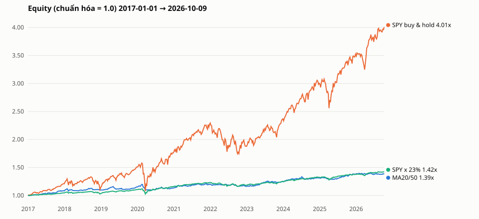

# Báo cáo backtest — MA crossover hằng tuần

Sinh bởi `python -m tradingbot backtest`. Vốn ban đầu 100,000 $ ở mỗi giai đoạn. Dữ liệu ngày 2016-01-04 → 2026-10-09 (feed `sip`, giá điều chỉnh chia tách + cổ tức). Chiến lược, risk manager, hàm stop/sizing/lệch giá là CÙNG code với lần chạy thật.

## 1. Bảng so sánh

### Giai đoạn đầy đủ: 2017-01-01 → 2026-10-09

| Chiến lược | Tổng LN | LN/năm | Sharpe | Max DD | Exposure TB | Số lệnh | Tỷ lệ thắng | Giữ TB (ngày) | Chi phí ($) |
|---|---|---|---|---|---|---|---|---|---|
| MA20/50 | +39.2% | +3.5% | 0.76 | 9.5% | 23.4% | 231 | 37.7% | 64 | 1,446 |
| MA20/50 (HALT = stop) | +39.2% | +3.5% | 0.76 | 9.5% | 23.4% | 231 | 37.7% | 64 | 1,446 |
| SPY buy & hold | +300.8% | +15.3% | 0.89 | 33.8% | 100.0% | 0 | – | – | 50 |
| SMA200 SPY | +181.8% | +11.2% | 0.95 | 17.6% | 82.6% | 13 | 46.2% | 213 | 2,128 |
| random x50: trung vị [p5; p95] | +64.7% [+40.3%; +85.0%] | +5.3% [+3.5%; +6.5%] | 1.08 [0.79; 1.29] | 8.1% [5.6%; 11.2%] | 23.5% [21.7%; 26.8%] | 232 [212; 252] | 37.0% [32.4%; 40.9%] | 63 [55; 73] | 1,578 [1,363; 1,714] |

### Giai đoạn out-of-sample của walk-forward: 2019-01-01 → 2026-10-09

| Chiến lược | Tổng LN | LN/năm | Sharpe | Max DD | Exposure TB | Số lệnh | Tỷ lệ thắng | Giữ TB (ngày) | Chi phí ($) |
|---|---|---|---|---|---|---|---|---|---|
| MA20/50 | +26.8% | +3.1% | 0.69 | 9.5% | 22.5% | 189 | 36.0% | 60 | 1,102 |
| walk-forward | +21.4% | +2.5% | 0.66 | 6.8% | 19.6% | 163 | 33.7% | 60 | 938 |
| MA20/50 (HALT = stop) | +26.8% | +3.1% | 0.69 | 9.5% | 22.5% | 189 | 36.0% | 60 | 1,102 |
| SPY buy & hold | +254.5% | +17.7% | 0.96 | 33.8% | 99.9% | 0 | – | – | 50 |
| SMA200 SPY | +150.8% | +12.6% | 1.04 | 17.2% | 80.1% | 10 | 50.0% | 209 | 1,575 |
| random x50: trung vị [p5; p95] | +52.3% [+33.8%; +79.6%] | +5.6% [+3.8%; +7.8%] | 1.09 [0.81; 1.40] | 8.2% [5.7%; 11.1%] | 24.4% [21.9%; 27.4%] | 182 [169; 208] | 36.8% [33.0%; 41.8%] | 64 [54; 76] | 1,221 [1,064; 1,366] |

- Sharpe: lợi suất ngày, lãi suất phi rủi ro = 0, nhân √252. LN/năm theo 252 phiên/năm.
- Exposure = giá trị cổ phiếu đang giữ / equity, trung bình theo ngày. Số lệnh = số vòng mua-bán đã đóng.
- `HALT = stop`: biến thể drawdown breaker dừng hẳn (giữ tiền mặt đến hết); dòng chính tiếp tục tuần sau và đặt lại đỉnh tại ngày HALT.
- Ngẫu nhiên: cùng engine + risk manager + stop + breaker; mỗi tuần mỗi mã chưa giữ được đề xuất mua với xác suất 0.087, mỗi vị thế được đề xuất thoát với xác suất 0.050 (hiệu chỉnh theo tần suất tín hiệu của MA20/50 giai đoạn đầy đủ).
- SMA200 SPY: mỗi thứ Hai, close > SMA200 → 100% SPY, ngược lại 100% tiền mặt; không stop.

**So với SPY cùng mức exposure** (23.4% SPY + phần còn lại tiền mặt lãi 0%, cân bằng hằng ngày): tổng lợi nhuận +42.4%, so với MA20/50 +39.2%.

**Kiểm tra mua-và-giữ SPY**: tính tay close cuối 778.57 / open đầu 194.17 − 1 = +300.973%; mô phỏng = +300.773% (chênh -0.200%, do trượt giá lúc mua).

## 2. Theo từng năm

| Năm | MA20/50 | SPY buy & hold | Walk-forward | Exposure MA20/50 |
|---|---|---|---|---|
| 2017 | +8.1% | +20.9% | – | 29.3% |
| 2018 | +1.6% | -5.0% | – | 24.4% |
| 2019 | +4.7% | +31.1% | +5.7% | 26.4% |
| 2020 | -1.4% | +18.5% | -0.8% | 20.7% |
| 2021 | +6.0% | +28.6% | +4.8% | 29.1% |
| 2022 | -3.3% | -18.2% | -5.3% | 13.5% |
| 2023 | +7.6% | +26.2% | +7.4% | 22.4% |
| 2024 | +4.7% | +24.9% | +2.6% | 28.5% |
| 2025 | +5.6% | +17.7% | +6.5% | 18.2% |
| 2026 | +0.6% | +15.1% | -0.6% | 21.7% |

Năm đầu/cuối là năm không trọn. Walk-forward bắt đầu từ giai đoạn out-of-sample.

## 3. Tham số walk-forward theo cửa sổ

Train 3 năm / test 6 tháng, chọn cặp có Sharpe train cao nhất trong lưới 10/50, 10/100, 20/50, 20/100, 30/50, 30/100 (hòa → thứ tự lưới). Train chỉ nhận dữ liệu đến ngày trước cửa sổ test. Cửa sổ train đầu tiên mất khoảng nửa năm khởi động chỉ báo (dữ liệu bắt đầu 2016).

| Test | Train | Chọn | Sharpe train của cặp được chọn |
|---|---|---|---|
| 2019-01-01 → 2019-06-30 | 2016-01-01 → 2018-12-31 | 30/50 | 1.26 |
| 2019-07-01 → 2019-12-31 | 2016-07-01 → 2019-06-30 | 10/100 | 1.30 |
| 2020-01-01 → 2020-06-30 | 2017-01-01 → 2019-12-31 | 10/100 | 1.31 |
| 2020-07-01 → 2020-12-31 | 2017-07-01 → 2020-06-30 | 10/50 | 0.67 |
| 2021-01-01 → 2021-06-30 | 2018-01-01 → 2020-12-31 | 10/50 | 0.65 |
| 2021-07-01 → 2021-12-31 | 2018-07-01 → 2021-06-30 | 10/100 | 1.06 |
| 2022-01-01 → 2022-06-30 | 2019-01-01 → 2021-12-31 | 10/100 | 1.19 |
| 2022-07-01 → 2022-12-31 | 2019-07-01 → 2022-06-30 | 30/100 | 0.90 |
| 2023-01-01 → 2023-06-30 | 2020-01-01 → 2022-12-31 | 10/100 | 0.90 |
| 2023-07-01 → 2023-12-31 | 2020-07-01 → 2023-06-30 | 30/50 | 1.38 |
| 2024-01-01 → 2024-06-30 | 2021-01-01 → 2023-12-31 | 30/50 | 1.05 |
| 2024-07-01 → 2024-12-31 | 2021-07-01 → 2024-06-30 | 10/50 | 1.32 |
| 2025-01-01 → 2025-06-30 | 2022-01-01 → 2024-12-31 | 30/50 | 1.33 |
| 2025-07-01 → 2025-12-31 | 2022-07-01 → 2025-06-30 | 30/50 | 1.29 |
| 2026-01-01 → 2026-06-30 | 2023-01-01 → 2025-12-31 | 30/100 | 1.70 |
| 2026-07-01 → 2026-10-09 | 2023-07-01 → 2026-06-30 | 30/50 | 1.05 |

Sharpe train của mọi cặp: `walk_forward_params.csv`.

## 4. Sự kiện circuit breaker

| Lần chạy | Ngày | Loại | Equity | Đỉnh | Drawdown | LN tuần trước | Đã bán |
|---|---|---|---|---|---|---|---|
| sensitivity: stop 2.0xATR, cap 10% | 2020-03-02 | weekly_loss | 132,504 | 145,214 | 8.8% | -7.3% | – |
| sensitivity: stop 2.0xATR, cap 10% | 2020-03-09 | drawdown_halt | 126,061 | 145,214 | 13.2% | -0.5% | AMZN GOOGL MSFT NVDA |
| sensitivity: stop 2.5xATR, cap 10% | 2020-03-02 | weekly_loss | 132,331 | 145,296 | 8.9% | -7.5% | – |
| sensitivity: stop 2.5xATR, cap 10% | 2020-03-09 | drawdown_halt | 125,872 | 145,296 | 13.4% | -0.5% | AMZN GOOGL MSFT NVDA |
| sensitivity: stop 3.0xATR, cap 10% | 2020-03-02 | weekly_loss | 134,585 | 147,179 | 8.6% | -7.1% | META |
| sensitivity: stop 3.0xATR, cap 10% | 2020-03-09 | drawdown_halt | 128,272 | 147,179 | 12.8% | +0.1% | AMZN GOOGL JNJ MSFT NVDA |
| random full seed 3 | 2020-03-02 | weekly_loss | 114,527 | 121,809 | 6.0% | -5.3% | – |
| random full seed 3 | 2020-03-16 | drawdown_halt | 109,115 | 121,809 | 10.4% | -1.6% | AAPL JPM NVDA |
| random full seed 13 | 2022-10-03 | drawdown_halt | 111,049 | 123,577 | 10.1% | -0.4% | JNJ JPM NVDA |
| random full seed 26 | 2024-08-05 | drawdown_halt | 150,743 | 169,470 | 11.0% | -1.4% | AAPL AMZN GOOGL JNJ META NVDA |
| random full seed 33 | 2023-01-30 | drawdown_halt | 135,641 | 151,703 | 10.6% | -0.8% | JNJ PG |
| random full seed 40 | 2022-09-26 | drawdown_halt | 131,664 | 146,498 | 10.1% | -1.0% | JNJ NVDA XOM |
| random full seed 45 | 2025-04-21 | drawdown_halt | 145,487 | 161,842 | 10.1% | -0.4% | GOOGL JNJ |
| random full seed 48 | 2025-04-07 | drawdown_halt | 141,443 | 161,808 | 12.6% | -4.3% | META |
| random full seed 49 | 2020-03-16 | drawdown_halt | 115,175 | 128,544 | 10.4% | -2.5% | AAPL MSFT NVDA |

## 5. Lệnh mua bị chặn theo lý do

| Lý do | MA20/50 full | walk-forward | random full (mean of 50) |
|---|---|---|---|
| correlation | 28 | 27 | 28.7 |
| drawdown_halt | 0 | 0 | 0.1 |
| gap_too_large | 4 | 5 | 9.3 |
| weekly_limit | 5 | 3 | 1.0 |

## 6. Danh sách lệnh

`trades.csv` (MA20/50 giai đoạn đầy đủ, 237 lệnh) và `trades_walk_forward.csv` (167 lệnh): ngày vào/ra, giá tham chiếu, giá khớp, số lượng, stop, lý do thoát (`signal`, `stop`, `stop_gap`, `drawdown_halt`, `open` = còn giữ cuối kỳ, định giá theo close cuối), lời/lỗ sau chi phí.

## 7. Equity

`equity.svg` / `equity.csv`: MA20/50 so với SPY mua-và-giữ và SPY × 23% (cùng mức exposure trung bình).

## 8. Độ nhạy (CHỈ để báo cáo, config không đổi)

MA20/50, giai đoạn đầy đủ. Config hiện tại: stop 2×ATR, giới hạn vị thế 5%.

| Stop | Giới hạn vị thế | Tổng LN | LN/năm | Sharpe | Max DD | Exposure TB | Số lệnh | Tỷ lệ thắng | Số HALT |
|---|---|---|---|---|---|---|---|---|---|
| 2×ATR (config) | 5% | +39.2% | +3.5% | 0.76 | 9.5% | 23.4% | 231 | 37.7% | 0 |
| 2.5×ATR | 5% | +36.8% | +3.3% | 0.69 | 9.5% | 24.8% | 230 | 40.0% | 0 |
| 3×ATR | 5% | +43.8% | +3.8% | 0.76 | 9.2% | 26.6% | 227 | 43.2% | 0 |
| 2×ATR | 10% | +98.4% | +7.3% | 0.85 | 14.3% | 46.2% | 231 | 38.1% | 1 |
| 2.5×ATR | 10% | +91.7% | +6.9% | 0.78 | 14.2% | 48.8% | 230 | 40.4% | 1 |
| 3×ATR | 10% | +108.8% | +7.8% | 0.85 | 13.6% | 51.7% | 226 | 43.8% | 1 |

## 9. Giới hạn của backtest

- **Survivorship bias**: watchlist được chọn hôm nay từ những công ty thành công (NVDA, META, AAPL, MSFT, AMZN, GOOGL...). Năm 2016 không ai biết trước danh sách này, nên kết quả bị thổi phồng, nhất là với chiến lược chỉ mua (long-only) và với benchmark ngẫu nhiên trên cùng danh sách.
- **Dữ liệu**: Alpaca daily bars feed `sip` (SIP = toàn thị trường; IEX chỉ có từ 2020-07 và là một phần nhỏ khối lượng). Chỉ có dữ liệu từ 2016-01-04, nên chỉ có ~9.8 năm so sánh (không có 2008, 2000) và cửa sổ train đầu tiên ngắn hơn 3 năm thực tế.
- **Giá điều chỉnh** (adjustment=all): cổ tức được cộng vào giá, nên lợi nhuận là tổng lợi nhuận; số cổ phiếu và phí theo cổ phiếu (TAF) tính trên giá điều chỉnh, khác chút với thực tế. Lần chạy thật dùng giá giao dịch thô và close thô cho kiểm tra lệch giá; backtest dùng open/close điều chỉnh.
- **Giá vào lệnh**: lần chạy thật khớp lúc ~11:07 New York (giá giao dịch mới nhất); backtest dùng giá open thứ Hai + trượt giá 5 bps. Lệnh bán theo tín hiệu cũng khớp ở open.
- **Stop**: khớp nếu low ≤ stop (ở giá stop) hoặc open ≤ stop (ở giá open), tính cả ngày vào lệnh. Không mô phỏng thứ tự giá trong ngày, thanh khoản, hay việc Alpaca hủy lệnh GTC sau 90 ngày (lần chạy thật đặt lại stop gốc mỗi tuần).
- **Circuit breakers** chỉ xét lúc chạy thứ Hai (như thật). Lịch sử equity cho breaker = giá trị đóng cửa hằng ngày trong 1 năm gần nhất (như portfolio history 1A của Alpaca). Sau HALT, dòng chính giả định người dùng đã xem xét và xóa HALT.lock để chạy tiếp tuần sau với đỉnh mới; lần chạy thật cần người can thiệp.
- **Giới hạn 3 vị thế/tuần**: chỉ chạy thứ Hai nên số lệnh mua trước đó trong tuần luôn là 0.
- **Không mô phỏng**: lãi tiền mặt (0%), cổ tức nhận bằng tiền (đã nằm trong giá điều chỉnh), lỗi API, lệnh bị từ chối, nghỉ giao dịch đột xuất, thuế. Tương quan, ATR, MA tính trên cửa sổ 400 ngày lịch như lần chạy thật.
- **Mua-và-giữ / SMA200**: cổ phiếu lẻ (fractional), toàn bộ vốn, không cash buffer.
- **Ngẫu nhiên**: cùng watchlist (cùng survivorship bias), nên nó đo giá trị của *thời điểm* vào/ra, không đo giá trị của việc chọn cổ phiếu.
- Walk-forward chỉ có lưới 6 cặp; số cửa sổ ít nên kết quả chọn tham số có nhiễu lớn.
- Thứ Hai nghỉ lễ (không giao dịch tuần đó, cửa sổ tín hiệu tuần sau mở rộng): 50 lần trong giai đoạn đầy đủ.
